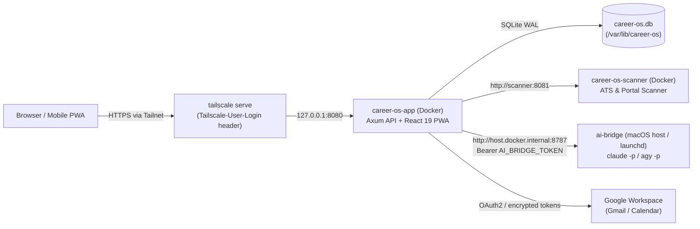

# career-os

Self-hosted, single-user job-search operating system built for Apple Silicon and Linux via Docker Compose over Tailscale.

`career-os` pairs a Rust/Axum API + SQLite WAL core with a React 19 PWA, a containerized ATS/portal scanner, and a host-side AI bridge (`launchd`) that invokes your local CLI agent (`claude -p` or `agy -p`) without embedding LLM API keys inside containers.

## Architecture



## Key Features

- **Single-user zero-trust ingress:** Binds exclusively to `127.0.0.1:8080` and authenticates requests via Tailscale identity headers (`ALLOWED_TAILSCALE_USER`).
- **Rust + SQLite WAL backend:** Fast, low-footprint Axum service with encrypted OAuth token storage (`TOKEN_ENCRYPTION_KEY`) and structured pipeline/application state.
- **React 19 PWA:** Mobile-friendly interface served statically by Axum (`STATIC_DIR=/app/static`).
- **Isolated scanner sidecar:** Internal-only Node.js container (`scanner:8081`) for zero-LLM-cost portal and ATS scraping.
- **Host AI bridge:** Lightweight macOS `launchd` service exposing local `claude -p` / `agy -p` execution over `host.docker.internal:8787`.
- **Source-of-truth discipline:** Fact-grounded resume and outreach generation with strict separation between system code and private candidate data.

## Quickstart

### 1. Configure environment

```bash
cp .env.example .env
```

Edit `.env` and set at minimum:
- `ALLOWED_TAILSCALE_USER` — your Tailscale login email (e.g. `you@example.com`)
- `AI_BRIDGE_TOKEN` — a random shared secret matching your `ai-bridge` plist
- `TOKEN_ENCRYPTION_KEY` — base64-encoded 32-byte key (`openssl rand -base64 32`)
- `DATA_DIR` (optional) — host path to your private candidate data directory (mounted read-only at `/data`)

### 2. Start containers

```bash
docker compose up -d
```

Expose the local port privately on your tailnet:

```bash
tailscale serve --bg http://127.0.0.1:8080
```

Your instance will be reachable only by your tailnet user at `https://your-mac-mini.your-tailnet.ts.net`.

### 3. Set up `ai-bridge` (macOS launchd)

Copy the example launchd plist and fill in your local paths and `AI_BRIDGE_TOKEN`:

```bash
cp deploy/launchd/com.career-os.ai-bridge.plist.example ~/Library/LaunchAgents/com.career-os.ai-bridge.plist
launchctl load -w ~/Library/LaunchAgents/com.career-os.ai-bridge.plist
```

### 4. Configure Google OAuth (optional)

1. Create a Web Application OAuth 2.0 client in Google Cloud Console.
2. Add your callback URL (`https://your-mac-mini.your-tailnet.ts.net/api/auth/google/callback` or `http://localhost:8080/api/auth/google/callback` for local dev) to Authorized Redirect URIs.
3. Populate `GOOGLE_CLIENT_ID`, `GOOGLE_CLIENT_SECRET`, and `GOOGLE_REDIRECT_URI` in `.env`, then restart:

```bash
docker compose up -d
```

## Repository Structure

```text
career-os/
├── crates/                 # Rust workspace (Axum API, domain models, SQLite store)
├── web/                    # React 19 + TypeScript + Vite PWA
├── scanner/                # Node.js ATS & job-board scanner service
├── deploy/
│   └── launchd/            # macOS launchd plist templates for host ai-bridge
├── docs/                   # Charter, architecture, glossary, trust model, ADRs
├── project/                # Session handoff state and OpenSpec change proposals
├── .agents/skills/         # Cross-agent workflow skills (OpenSpec + GSD)
├── .claude/skills/         # Symlinks to .agents/skills/ for Claude Code parity
├── .github/workflows/      # CI checks and multi-arch GHCR image publishing
├── Dockerfile              # Multi-stage build (web + Rust API + distroless runtime)
├── scanner.Dockerfile      # Minimal Node.js Alpine image for scanner sidecar
├── docker-compose.yml      # Local single-user stack (app + scanner)
└── .env.example            # Documented runtime configuration template
```

## Development

- **Rust API:** `cargo fmt --check && cargo clippy --all-targets -- -D warnings && cargo test`
- **Web PWA:** `cd web && npm ci && npm run typecheck && npm test && npm run build`
- **Scanner:** `cd scanner && npm ci && npm test`

## License

[MIT](LICENSE)
