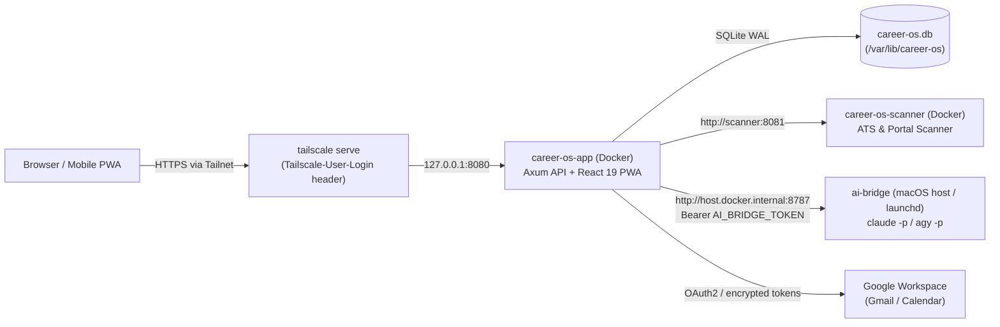

# career-os

Self-hosted, single-user job-search operating system built for Apple Silicon and Linux via Docker Compose over Tailscale.

`career-os` pairs a Rust/Axum API + SQLite WAL core with a React 19 PWA, a containerized ATS/portal scanner, and a host-side AI bridge (`launchd`) that invokes your local CLI agent (`claude -p` or `agy -p`) without embedding LLM API keys inside containers.

## Architecture



## Key Features

- **Single-user zero-trust ingress:** Binds exclusively to `127.0.0.1:8080` and authenticates requests via Tailscale identity headers (`ALLOWED_TAILSCALE_USER`).
- **Rust + SQLite WAL backend:** Fast, low-footprint Axum service with encrypted OAuth token storage (`TOKEN_ENCRYPTION_KEY`) and structured pipeline/application state.
- **React 19 PWA:** Mobile-friendly interface served statically by Axum (`STATIC_DIR=/app/static`).
- **Isolated scanner sidecar:** Internal-only Node.js container (`scanner:8081`) for zero-LLM-cost portal and ATS scraping.
- **Host AI bridge:** Small Rust `launchd` service that runs your local `claude` / `agy` CLI with tools disabled, reachable from the app at `host.docker.internal:8787`.
- **Source-of-truth discipline:** Fact-grounded resume and outreach generation with strict separation between system code and private candidate data.

## Quickstart

### 1. Configure environment

```bash
cp .env.example .env
```

Edit `.env` and set at minimum:
- `ALLOWED_TAILSCALE_USER` — your Tailscale login email (e.g. `you@example.com`)
- `AI_BRIDGE_TOKEN` — the shared secret from step 3 (`openssl rand -hex 32`); leave empty until the bridge is set up
- `TOKEN_ENCRYPTION_KEY` — base64-encoded 32-byte key (`openssl rand -base64 32`)
- `DATA_DIR` (optional) — host path to your private candidate data directory (mounted read-only at `/data`)

### 2. Start containers

```bash
docker compose up -d
```

Published GHCR images are `linux/arm64` only (Apple Silicon / ARM Linux). On an x86_64 host, build locally instead: `docker compose up -d --build`.

Expose the local port privately on your tailnet:

```bash
tailscale serve --bg http://127.0.0.1:8080
```

Your instance will be reachable only by your tailnet user at `https://your-mac-mini.your-tailnet.ts.net`.

### 3. Set up `ai-bridge` (macOS launchd)

The bridge is a small Rust service on the host. It runs your logged-in `claude` and/or `agy` CLI with **no tools**: the prompt goes in on stdin, it runs in a private work folder with a minimal environment, and agy's saved conversations are deleted after each run. Job posting text is treated as untrusted data. Background and trade-offs: [ADR-002](docs/adr/ADR-002-ai-bridge-cli-isolation.md) and [docs/trust.md](docs/trust.md).

Prerequisites: Rust (`rustup`), and `claude` and/or `agy` installed and logged in (default location `~/.local/bin`).

```bash
# 1. Build and install the binary to ~/.local/bin/career-os-ai-bridge
cargo install --path crates/ai-bridge --locked --root ~/.local

# 2. Create a shared token (put the same value in .env as AI_BRIDGE_TOKEN)
openssl rand -hex 32

# 3. Install the LaunchAgent, then edit it: replace every `your-user` and the token
cp deploy/launchd/com.career-os.ai-bridge.plist.example ~/Library/LaunchAgents/com.career-os.ai-bridge.plist
chmod 600 ~/Library/LaunchAgents/com.career-os.ai-bridge.plist
launchctl bootstrap gui/$(id -u) ~/Library/LaunchAgents/com.career-os.ai-bridge.plist

# 4. Check it
curl -s http://127.0.0.1:8787/healthz
```

`/healthz` shows `"status":"ok"` and which CLIs the bridge can find. If it isn't running, check `~/Library/Logs/career-os-ai-bridge.err.log`: the bridge refuses to start with a missing, short (< 32 chars), or placeholder token. After rebuilding, restart it with `launchctl kickstart -k gui/$(id -u)/com.career-os.ai-bridge`; to remove it, `launchctl bootout gui/$(id -u)/com.career-os.ai-bridge`. After upgrading `claude` or `agy`, re-run the tool-isolation smoke test: `cargo test -p career-os-ai-bridge --test cli_smoke -- --ignored --nocapture`.

**Container runtime.** The bridge listens on host loopback only; the app container reaches it at `host.docker.internal:8787` (`extra_hosts: host-gateway` in `docker-compose.yml`). Docker Desktop and OrbStack forward that to host loopback. Kiri documents the same but is beta, so check from a container (the app image is distroless, so use a throwaway one): `docker run --rm --add-host=host.docker.internal:host-gateway alpine wget -qO- http://host.docker.internal:8787/healthz`.

Bridge settings (plist `EnvironmentVariables`):

| Variable | Default | Purpose |
|---|---|---|
| `AI_BRIDGE_TOKEN` | — (required) | Shared bearer token, ≥ 32 chars |
| `AI_BRIDGE_BIND` | `127.0.0.1:8787` | Listen address (keep it on loopback) |
| `AI_BRIDGE_PRIMARY` | `claude` | Default CLI (`claude` or `agy`); requests can override |
| `AI_BRIDGE_MAX_CONCURRENCY` | `2` | Max CLI runs at once; extra requests wait, then get 503 `BRIDGE_BUSY` |
| `AI_BRIDGE_TIMEOUT_SECS` | `90` | Default per-run timeout (requests may set 5–300) |
| `AI_BRIDGE_COOLDOWN_SECS` | `300` | How long a rate-limited CLI is skipped |
| `AI_BRIDGE_WORKDIR` | `~/Library/Application Support/career-os-ai-bridge/work` | Private run folder |
| `AI_BRIDGE_CLAUDE_BIN` / `AI_BRIDGE_AGY_BIN` | `claude` / `agy` | CLI names or absolute paths |
| `AI_BRIDGE_{CLAUDE,AGY}_{HYDROGEN,NEON,CARBON}_MODEL` | see `crates/ai-bridge/src/config.rs` | Model per tier |
| `CLAUDE_STATUSLINE_PATH` | unset | Claude usage file (below) |
| `AI_BRIDGE_STATUSLINE_MAX_AGE_SECS` | `900` | Usage older than this is marked stale |

**Claude usage in the Usage Bar (optional).** Claude Code passes your 5-hour and 7-day usage to its status line. To share it with the bridge, add this to `~/.claude/settings.json` (if you already have a `statusLine`, put the `tee` part in front of your own command):

```json
{
  "statusLine": {
    "type": "command",
    "command": "f=\"$HOME/Library/Application Support/career-os-ai-bridge/statusline.json\"; cat > \"$f.tmp\" && mv \"$f.tmp\" \"$f\"; echo career-os"
  }
}
```

The file only refreshes while you use Claude Code interactively, so the bar shows it as stale after `AI_BRIDGE_STATUSLINE_MAX_AGE_SECS`.

### 4. Configure Google OAuth (Testing Mode) & LA Commute Maps (optional)

1. In your Google Cloud project (`Career-Ops`), keep the OAuth consent screen intentionally in **Testing mode** (add yourself as a test user; the PWA surfaces a 7-day countdown and `<24h` 1-click reconnect pill).
2. Add your callback URL (`https://your-mac-mini.your-tailnet.ts.net/api/auth/google/callback` or `http://localhost:8080/api/auth/google/callback` for local dev) to Authorized Redirect URIs.
3. Optionally enable **Places API (New)** and **Routes API** and set `GOOGLE_MAPS_API_KEY`, `HOME_LOCATION_AREA` (neighborhood/city only, e.g. `West Los Angeles, CA`), and `DEFAULT_TRAVEL_MODE` (`drive` or `transit`) in `.env` to compute cached commute estimates for non-remote roles.
4. Populate `GOOGLE_CLIENT_ID`, `GOOGLE_CLIENT_SECRET`, and `GOOGLE_REDIRECT_URI` in `.env`, then restart:

```bash
docker compose up -d
```

## Repository Structure

```text
career-os/
├── crates/                 # Rust workspace (Axum API, domain models, SQLite store)
├── web/                    # React 19 + TypeScript + Vite PWA
├── scanner/                # Node.js 26 ATS & job-board scanner service
├── deploy/
│   └── launchd/            # macOS launchd plist templates for host ai-bridge
├── docs/                   # Charter, architecture, glossary, trust model, ADRs
├── project/                # Session handoff state and OpenSpec change proposals
├── .agents/skills/         # Cross-agent workflow skills (OpenSpec + GSD)
├── .claude/skills/         # Symlinks to .agents/skills/ for Claude Code parity
├── .github/workflows/      # Stack-filtered CI Gate, auto-merge, and GHCR release workflows
├── Dockerfile              # Multi-stage build (Node 26 web + cargo-chef Trixie + Distroless Debian 13)
├── scanner.Dockerfile      # Minimal node:26-alpine image for scanner sidecar
├── docker-compose.yml      # Local single-user stack (app + scanner)
└── .env.example            # Documented runtime configuration template
```

## Development

- **Rust API:** `cargo fmt --check && cargo clippy --all-targets -- -D warnings && cargo test`
- **Web PWA:** `cd web && npm ci && npm run typecheck && npm test && npm run build`
- **Scanner:** `cd scanner && npm ci && npm test`

## License

[MIT](LICENSE)
