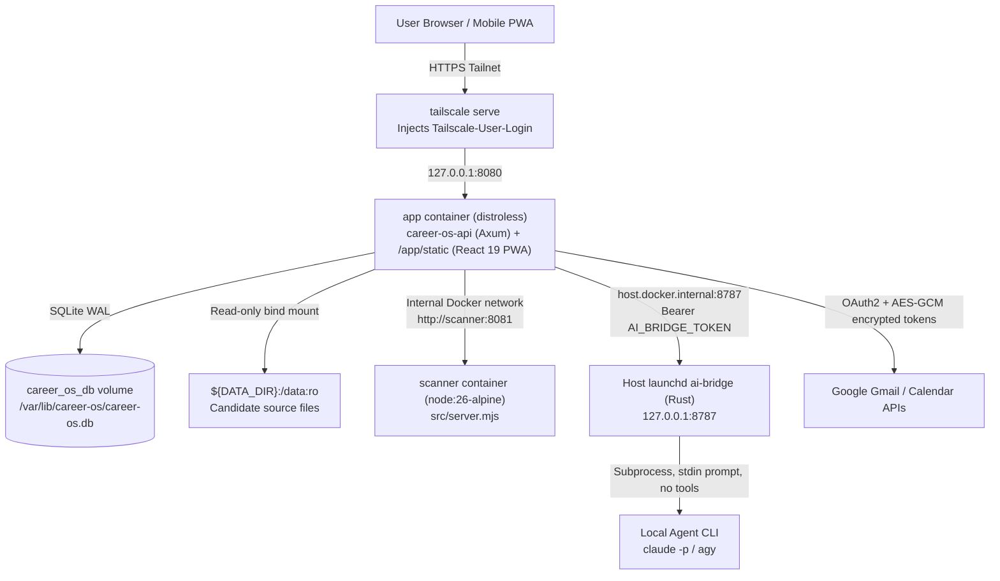

# Architecture

`career-os` uses a split-plane architecture separating the persistent Rust API/UI core, an isolated ATS scanner container, and a host-side AI CLI bridge.

## System Topology

## Components

| Component | Runtime | Responsibility |
| --- | --- | --- |
| `career-os-api` | Rust (`crates/`), `gcr.io/distroless/cc-debian13:nonroot` (digest-pinned, UID 65532, `--healthcheck` probe, SIGTERM-graceful) | HTTP API, static PWA serving, SQLite WAL state, Tailscale user verification, OAuth token encryption (`TOKEN_ENCRYPTION_KEY`), scanner & AI bridge orchestration. |
| `web` | React 19 + Vite + TypeScript (`web/`) | Compiled into `/app/static` at image build time; mobile-ready PWA for pipeline review, job evaluation, and status tracking. |
| `scanner` | Node.js 26 LTS (`scanner/`, `node:26-alpine`) | Internal-only sidecar on port `8081` (no host port binding) handling ATS API polling and HTML job-board fetching. |
| `ai-bridge` | Rust (`crates/ai-bridge`) on the macOS host (`launchd`, `deploy/launchd/`) | Listens on `127.0.0.1:8787`, requires `AI_BRIDGE_TOKEN` (≥ 32 chars, no placeholders), and runs `claude` or `agy` with tools disabled: prompt on stdin, private 0700 workdir, minimal env, agy conversation deleted after each run. Per-request primary CLI and failover, concurrency cap, typed Claude usage from the statusline. See [ADR-002](adr/ADR-002-ai-bridge-cli-isolation.md). |

## Network & Storage Boundaries

- **Ingress:** Only `127.0.0.1:8080` is published on the host. Remote access is mediated exclusively by `tailscale serve`.
- **Internal network:** `scanner` is reachable only on the Compose bridge network (`http://scanner:8081`).
## Google Sync & Linking (JOB-6)

- **Schedule:** the API syncs Gmail (inbox threads matching interview/application/recruiter) and upcoming Calendar events every `GOOGLE_SYNC_INTERVAL_HOURS` (default 12, so twice daily). Settings → **Sync now** (`POST /api/sync/google`) runs one immediately. A shared lock prevents two syncs from overlapping (409 `SYNC_IN_PROGRESS`), and each run is recorded in `sync_runs`.
- **Linking** (`crates/api/src/sync/link.rs`, no AI): after each sync, a thread is linked to an application when either:
  - the company name appears in the subject; or
  - the sender is the company's own domain, the job board's domain or a known ATS, **and** the company is named in the snippet.

  An event is linked when its title names the company. When several applications match, the most recently updated wins. Manual links (`PUT /api/gmail-threads/{id}/application`, `link_source='manual'`) are never overwritten.
- **Read surfaces:**
  - `GET /api/today`: linked replies that need an answer, the 7-day agenda, follow-ups due, and top-scored jobs still in triage.
  - `GET /api/tracker` and `PATCH /api/tracker`.
  - `GET /api/jobs/{id}` now includes `gmail_threads`, `calendar_events` and `email_draft`.
  - **Writes:** `POST /api/jobs/{id}/email-draft` saves the draft locally and, when confirmed, to Gmail Drafts (never sent, [ADR-003](adr/ADR-003-gmail-drafts-never-send.md)). `POST /api/jobs/{id}/calendar-reminder` creates a 30-minute Calendar event linked to the application and, for follow-ups, sets its follow-up date. Without Google, both return 409 `GOOGLE_NOT_CONNECTED`; after a revoked or expired grant, they return 409 `GOOGLE_RECONNECT_REQUIRED`.
  - The API uses the DB's stage names (`shortlisted/recruiter/interviewing/closed`); `web/src/api/jobs.ts` converts them to and from the UI's names (`saved/screen/interview/archived`).

- **Persistence:** Application state resides in the named Docker volume `career_os_db` (`/var/lib/career-os`) using SQLite WAL mode. Candidate source files are mounted read-only at `/data`.
