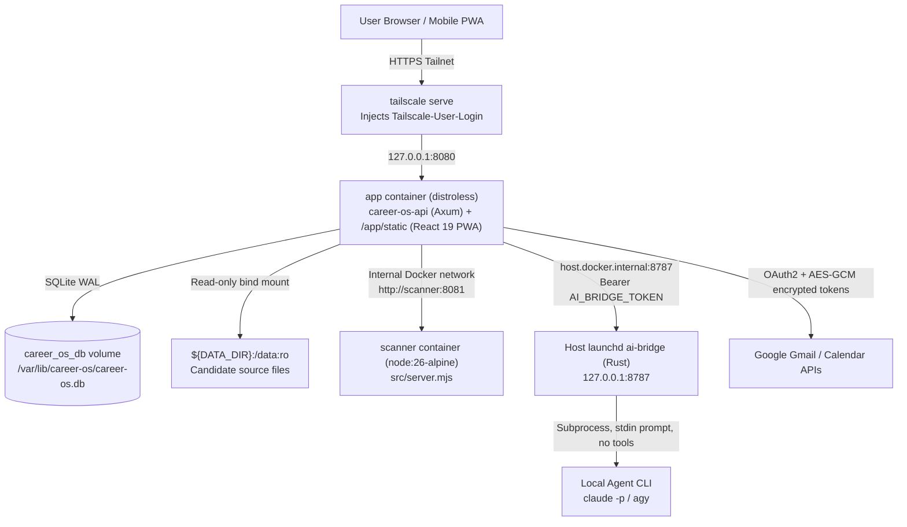

# Architecture

`career-os` uses a split-plane architecture separating the persistent Rust API/UI core, an isolated ATS scanner container, and a host-side AI CLI bridge.

## System Topology

## Components

| Component | Runtime | Responsibility |
| --- | --- | --- |
| `career-os-api` | Rust (`crates/`), `gcr.io/distroless/cc-debian13:nonroot` (digest-pinned, UID 65532, `--healthcheck` probe, SIGTERM-graceful) | HTTP API, static PWA serving, SQLite WAL state, Tailscale user verification, OAuth token encryption (`TOKEN_ENCRYPTION_KEY`), scanner & AI bridge orchestration. |
| `web` | React 19 + Vite + TypeScript (`web/`) | Compiled into `/app/static` at image build time; mobile-first Warm Paper Calm Native PWA built on `@base-ui/react` (`coss ui` copy-and-own primitives) and `@tanstack/react-table` featuring Focus Triage Paper Sheet + 4-Part Fit Horizon, `⌘K` Quick Capture, grouped Tracker, and Light/Dark/System themes. |
| `scanner` | Node.js 26 LTS (`scanner/`, `node:26-alpine`) | Internal-only sidecar on port `8081` (no host port binding) handling ATS API polling and HTML job-board fetching. |
| `ai-bridge` | Rust (`crates/ai-bridge`) on the macOS host (`launchd`, `deploy/launchd/`) | Listens on `127.0.0.1:8787`, requires `AI_BRIDGE_TOKEN` (≥ 32 chars, no placeholders), and runs `claude` or `agy` with tools disabled: prompt on stdin, private 0700 workdir, minimal env, agy conversation deleted after each run. Automatic quota-aware `auto` balancing across Claude and Gemini (`agy`) + instant failover, capability tiers (`fast`/`balanced`/`deep`), concurrency cap, typed Claude usage from the statusline. See [ADR-002](adr/ADR-002-ai-bridge-cli-isolation.md). |

## Network & Storage Boundaries

- **Ingress:** Only `127.0.0.1:8080` is published on the host. Remote access is mediated exclusively by `tailscale serve`.
- **Internal network:** `scanner` is reachable only on the Compose bridge network (`http://scanner:8081`).
## Google Sync & Linking (JOB-6)

- **Schedule:** the API syncs Gmail (inbox threads matching interview/application/recruiter) and upcoming Calendar events every `GOOGLE_SYNC_INTERVAL_HOURS` (default 12, so twice daily). Settings → **Sync now** (`POST /api/sync/google`) runs one immediately. A shared lock prevents two syncs from overlapping (409 `SYNC_IN_PROGRESS`), and each run is recorded in `sync_runs`.
- **Linking** (`crates/api/src/sync/link.rs`, no AI): after each sync, a thread is linked to an application when either:
  - the company name appears in the subject; or
  - the sender is the company's own domain, the job board's domain or a known ATS, **and** the company is named in the snippet.

  An event is linked when its title names the company. Event times are stored as UTC; events that Google no longer returns (deleted or cancelled) are pruned within the window the sync listed. When several applications match, the most recently updated wins. Manual links (`PUT /api/gmail-threads/{id}/application`, `link_source='manual'`) are never overwritten.
- **Read surfaces:**
  - `GET /api/today`: linked replies that need an answer, the 7-day agenda, follow-ups due, and top-scored jobs still in triage.
  - `GET /api/tracker` and `PATCH /api/tracker`.
  - `GET /api/jobs/{id}` now includes `gmail_threads`, `calendar_events` and `email_draft`.
  - **Writes:** `POST /api/jobs/{id}/email-draft` saves the draft locally and, when confirmed, to Gmail Drafts (never sent, [ADR-003](adr/ADR-003-gmail-drafts-never-send.md)). `POST /api/jobs/{id}/calendar-reminder` creates a 30-minute Calendar event linked to the application and, for follow-ups, sets its follow-up date. Without Google, both return 409 `GOOGLE_NOT_CONNECTED`; after a revoked or expired grant, they return 409 `GOOGLE_RECONNECT_REQUIRED`.
  - **Linear (optional):** with `LINEAR_API_KEY` and `LINEAR_TEAM_ID` set, `PATCH /api/tracker` moving a job to `applied` creates exactly one Linear issue. `applications.linear_issue_id` is claimed atomically; on failure the claim is released and the stage change still saves.
  - **Linear status (JOB-11):** `GET /api/integrations/linear` returns `{configured, team_key, issues[]}` (up to 20 applications with a stored identifier such as `JOB-42`, newest first) for the Settings card. It never returns the API key or team UUID.
  - **Replies needing an answer (JOB-11):** a synced thread has `needs_reply` when its last message is in `INBOX`, not `SENT`, and not automated: `no-reply`/`do-not-reply`/`notifications`/`mailer-daemon`/`postmaster` senders and Gmail's Promotions/Social/Forums categories are excluded. `CATEGORY_UPDATES` stays eligible because recruiter replies sent through an ATS often land there.
  - The API uses the DB's stage names (`shortlisted/recruiter/interviewing/closed`); `web/src/api/jobs.ts` converts them to and from the UI's names (`saved/screen/interview/archived`).

## Deployment (JOB-7)

- **Host:** the M2 Mac mini runs compose project `career-os` from the GHCR `latest` images (`restart: unless-stopped`; Docker Desktop starts at login). The ai-bridge runs under launchd.
- **Access:** `tailscale serve` maps `https://<host>.<tailnet>.ts.net:8080` to `127.0.0.1:8080`. Requests need the tailnet's `Tailscale-User-Login` to equal `ALLOWED_TAILSCALE_USER`: no header gets 401, another user gets 403.
- **Backups:** `scripts/backup-db.sh`, run nightly by launchd (`com.career-os.backup`), streams a `VACUUM INTO` snapshot out of the distroless container (`career-os-api --backup-stdout`), checks `PRAGMA integrity_check`, and keeps 14 days in `~/Backups/career-os/` (mode 700).
- **Job scanning:** `POST /api/sources/scan` and the 3-day schedule send all enabled sources to the scanner sidecar (`SCANNER_URL`, `/scan/ats`). The sidecar applies its provider registry, posting guard and target title, location and experience filters (45-day max age). Only accepted postings are ingested; rejected ones are logged in `filtered_audit` and shown on the Sources page. Without the sidecar, scans return 503 rather than ingest unfiltered postings.
- **Private data & personalized scoring (JOB-8 / JOB-9):** the private career-data repo is cloned outside this repository and mounted read-only at `/data` (`DATA_DIR`, read by `career-os-api` via `CAREER_OS_DATA_DIR`, default `/data`). `crates/api/src/profile/` parses `${CAREER_OS_DATA_DIR}/profile/` (`targeting.yml`, `skills.yml`, `identity.md`, `psych-and-vibe.md`, `experience.md`, `projects/*.md`), strips `tbd` sections from factual claims, forwards `targeting.yml` `scanner_filters` inside `portalsConfig` to `scanner`, and compiles a Triage Scoring Digest (`fast` tier: 4-dimension 0–100 breakdown + dealbreaker check) and Deep Analysis Dossier (`balanced` tier default, automatically escalated to `deep` when match score &ge; 75).
- **Google Drive Project Reports (`project_docs`):** when `GOOGLE_DRIVE_PROJECTS_FOLDER_ID` is set, `sync_google_workspace` and `POST /api/profile/sync-docs` list Google Docs strictly inside that folder, export new or modified Docs (`modifiedTime` change detection) as Markdown into SQLite `project_docs`, and run a compact `fast`-tier pass to cache a Project Card in `digest_json` (fed into batch scoring; full cached Markdown feeds Deep Analysis).
- **Google OAuth callback (JOB-11):** `GET /api/auth/google/callback` checks the single-use `state`, stores the encrypted token, and 303-redirects to `/settings?google=connected`, or to `/settings?google=error&reason=<denied|invalid_state|not_configured|exchange_failed>`. Only these fixed codes go in the URL, never error text. Settings shows the result once and removes the parameters with `history.replaceState`.
- **Commute preferences (JOB-11):** Settings saves `home_location_area` (non-empty, ≤ 120 chars) and `travel_mode` (`drive`/`transit`) through `PUT /api/settings/{key}`. The API validates both and uses them ahead of `HOME_LOCATION_AREA` and the default travel mode.
- **Demo data rule (JOB-11 / JOB-12):** the web client uses demo data only when `VITE_DEMO_MODE=true` or the request fails at the network level (`TypeError`). Every route the API implements (including `POST /api/jobs/{id}/tailor`) shows its real 4xx/5xx error.
- **Tailored Resume & Cover Letter Google Docs (JOB-12):** `POST /api/jobs/{id}/tailor` validates AI availability, job existence, loaded `DATA_DIR/profile` (`409 PROFILE_NOT_LOADED`), and Google auth (`409 GOOGLE_NOT_CONNECTED` / `GOOGLE_RECONNECT_REQUIRED`) before calling `ai-bridge` (`deep` tier default). It compiles a strictly factual dossier (excluding `psych-and-vibe.md`, `not_my_lane`, and `tbd` sections), renders HTML-escaped Markdown, uploads both Docs via `drive.file` (into optional `GOOGLE_DRIVE_OUTPUT_FOLDER_ID` or My Drive root), and persists links and `grounded_bullets` in `drive_artifacts` and `tailor_runs` for `GET /api/jobs/{id}`.
- **Read-only Profile & Rescore:** `GET /api/profile/status` exposes loaded local file statuses and synced `project_docs` metadata in Settings; `POST /api/ai/rescore` resets unapplied triage scores and runs a fresh `fast` scoring batch without touching `applications` or `blacklisted` rows.

- **Persistence:** Application state resides in the named Docker volume `career_os_db` (`/var/lib/career-os`) using SQLite WAL mode. Candidate source files are mounted read-only at `/data`.
