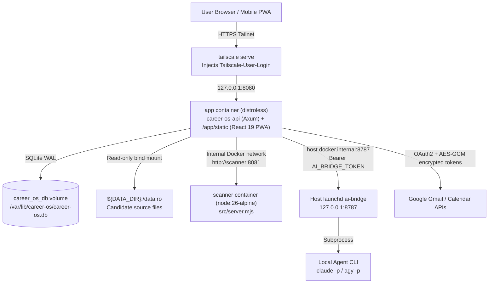

# Architecture

`career-os` uses a split-plane architecture separating the persistent Rust API/UI core, an isolated ATS scanner container, and a host-side AI CLI bridge.

## System Topology

## Components

| Component | Runtime | Responsibility |
| --- | --- | --- |
| `career-os-api` | Rust (`crates/`), `gcr.io/distroless/cc-debian12:nonroot` | HTTP API, static PWA serving, SQLite WAL state, Tailscale user verification, OAuth token encryption (`TOKEN_ENCRYPTION_KEY`), scanner & AI bridge orchestration. |
| `web` | React 19 + Vite + TypeScript (`web/`) | Compiled into `/app/static` at image build time; mobile-ready PWA for pipeline review, job evaluation, and status tracking. |
| `scanner` | Node.js 26 LTS (`scanner/`, `node:26-alpine`) | Internal-only sidecar on port `8081` (no host port binding) handling ATS API polling and HTML job-board fetching. |
| `ai-bridge` | Node.js on macOS host (`launchd`) | Listens on `127.0.0.1:8787`, authenticates requests with `AI_BRIDGE_TOKEN`, and executes `claude -p` or `agy -p` on the host machine. |

## Network & Storage Boundaries

- **Ingress:** Only `127.0.0.1:8080` is published on the host. Remote access is mediated exclusively by `tailscale serve`.
- **Internal network:** `scanner` is reachable only on the Compose bridge network (`http://scanner:8081`).
- **Persistence:** Application state resides in the named Docker volume `career_os_db` (`/var/lib/career-os`) using SQLite WAL mode. Candidate source files are mounted read-only at `/data`.
